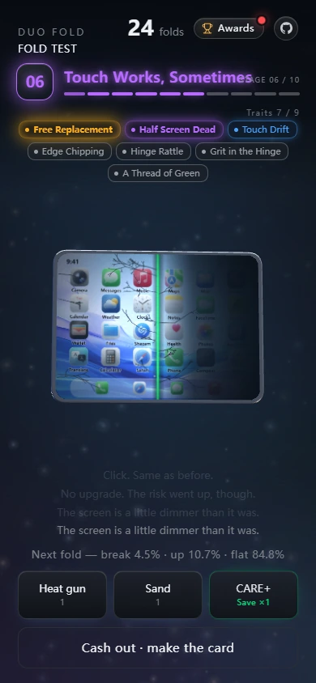
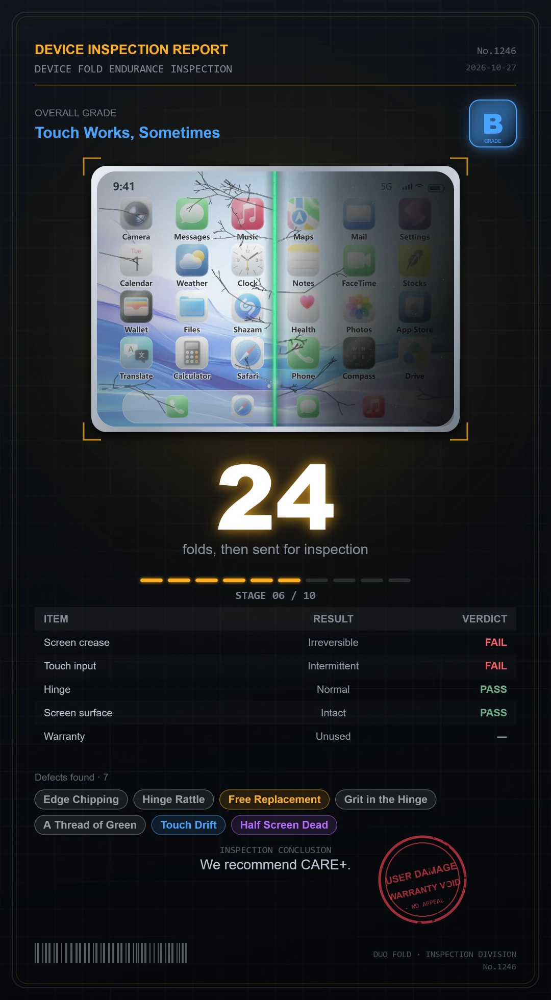

# Duo Fold — Fold Endurance Test

English | **[简体中文](README.md)**

> Every fold might destroy this ¥15,999 foldable on the spot. How many will you risk?

### **[Play in your browser →](https://silent-reader-cn.github.io/duo-fold-game/)**

Nothing to install · plays on phones · switches between Chinese and English automatically

## What this is

You are handed a ¥15,999 foldable phone. Each fold might raise its grade, might do nothing at
all, or might shatter it — and every fold makes the next one riskier.

It is a gamble, except the chip on the table is a phone. You can cash out whenever you like and
turn the run into a "device inspection report" you can post.

## How to play

- **Fold**: hold the body and drag sideways. Drag right to fold it up (the inner screen always faces you); drag left to bend it backwards — faster progress, more damage.
- **Keep folding**: hold the body still for 0.8 s and it starts folding on its own for as long as you keep holding; let go and it stops instantly. Haptics ramp from weak to strong while it charges.
- **Items**: heat gun (tears off the matte layer for one save plus doubled upgrade odds, at the price of +15% break chance), sand (into the hinge for one save, at the price of +13% and a lid that never closes flush). Neither is a buff — both are trades.
- **Cash out**: hit "Cash out · make the card" at any time and the run freezes into one image.

## What's in there

**10 grades**: Factory Sealed → First Crease → Visibly Creased → Occasional Flicker → A Thread of Green → Touch Works, Sometimes → Battle-Worn → Certified Wreck → Warranty Void → Legendary · Folds Apart

**25 defect traits**, tiered Common / Rare / Epic / Legendary, and the deeper you go the more often they roll. The legendary tier is the "wait, that's allowed?" kind — *Fake Self-Healing*, *No Report Issued*, and so on.

**CARE+ (extended warranty)**: the moment the screen shatters it swaps the phone automatically and your grade is kept — no downgrade. How many swaps you get depends on the best grade you have ever reached on this device: grade 8 → 2 swaps, 9 → 3, 10 → 4. Press the CARE+ button before your first fold to upgrade it.

**The result card**: one per run, with a grade (D to S), the inspection verdicts, the traits you picked up, and the red stamp.

## The numbers

| Play style | Average folds | Average grade | Reached grade 7+ | High grade + both item traits |
|---|---|---|---|---|
| No items | 29.4 folds | 6.53 | 51.4% | — |
| With items | ~20 folds | 5.21 | 12.2% | **0.067%** |

From 60,000 simulated runs. That last cell means roughly one run in 1500 manages both a high grade
*and* both item-exclusive traits. Items do not make you stronger, they make you faster.

## FAQ

**Do I need to install anything?**
No. Open it in a browser, desktop or phone. It needs WebGL2; very old machines, or a device in power-saving mode, may not provide it.

**Blank screen / won't start?**
A red diagnostic bar appears at the bottom of the page saying exactly which file failed to load or which step threw, with a **Retry** button next to it (it re-requests with a timestamp, which sheds stale caches). Send that line over and it can be pinned down.

**Where is my progress saved?**
In your own browser's localStorage, nowhere else — nothing is uploaded. Clearing site data, switching browsers, or using a private window will lose it.

**How do I change the language?**
It follows your browser: Chinese-language environments get Chinese, everything else gets English. To pin it, add `?lang=zh` or `?lang=en` to the URL.

**Best way to fold on a phone?**
Press on the body, drag sideways, then release. For auto-folding, press and hold without moving for 0.8 s.

## Note

This is a satirical folding-phone sim. It makes no claim about the design or quality of any real
product; it contains no official manufacturer assets, and every brand and person in it is fictional
(the logo is a durian with a bite taken out of it).

## License

MIT — play with it, change it, ship it. See [LICENSE](LICENSE).

Bugs and ideas: just open an issue. For how it is built (fold-screen maths, how the bilingual copy
is organised, how it is published), see [docs/03-实现说明.md](docs/03-实现说明.md) — written in Chinese.
