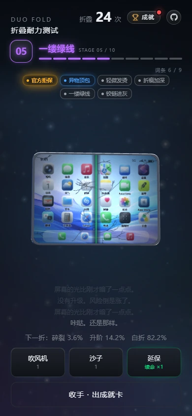
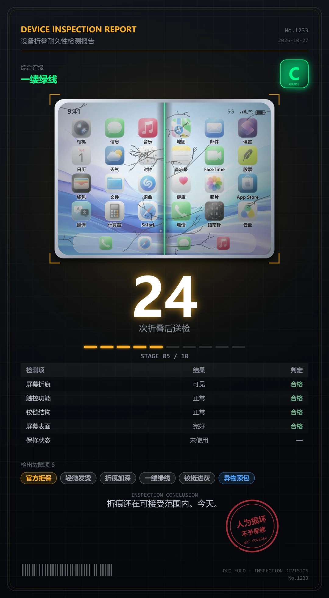

# Duo Fold · 折叠耐力测试

**[简体中文](README.md)** | [English](README.en.md)

> 每折一下，这台 15999 元的折叠屏都可能当场报废。你敢折几次？

### **[打开网页就玩 →](https://silent-reader-cn.github.io/duo-fold-game/)**

免安装 · 手机可玩 · 中英文自动切换

## 这是什么

一台 15999 元的折叠屏交到你手上。每折一次，它可能升阶、可能毫无反应、也可能当场碎成渣，而每一次折叠都会让下一次更危险。

说白了这是赌博，只是赌桌上摆的是一台手机。你随时可以收手，把这一局的成绩做成一张"设备检测报告"发出去。

## 怎么玩

- **折**：按住机身左右拖。向右折起（内屏始终朝你），向左掰弯——进度更快，也更伤机器。
- **连折**：按住机身不动 0.8 秒，之后只要不松手，它会自己一折一折往下走，松手立刻停。蓄力时震感从弱到强。
- **道具**：吹风机（撕掉磨砂层，换一次免死 + 升阶概率翻倍，代价是整体碎裂率 +15%）、沙子（塞进铰链，换一次免死，代价 +13% 且从此合不严）。都不是增强，是交易。
- **收手**：随时点「收手 · 出成就卡」，本局就定格成一张图。

## 有什么可挖

**10 个品阶**：全新未拆封 → 初见折痕 → 折痕明显 → 偶发闪屏 → 一缕绿线 → 触控时灵 → 久经沙场 → 战损成色 → 厂商拒保 → 传奇·一掰就碎

**25 条故障词条**，分普通 / 稀有 / 史诗 / 传说四档，越折越容易爆。传说级是那种"这也能行？"的东西——比如「假性自愈」「无检测报告」。

**延保（CARE+）**：屏幕碎掉的瞬间自动换机，品阶不倒扣。单局能换几次，看你在这台设备上历史最高折到过几阶：8 阶 2 次、9 阶 3 次、10 阶 4 次。开局前（还没折的时候）点一下延保按钮就能升级。

**成绩卡**：一局一张，带评级（D 到 S）、检测项判定、这一局拿到的词条，以及那枚红色印章。

## 数值真相

| 玩法 | 平均能折几次 | 平均品阶 | 折到 7 阶以上 | 高品阶 + 集齐两个道具词条 |
|---|---|---|---|---|
| 不用道具 | 29.4 折 | 6.53 | 51.4% | — |
| 用道具 | 约 20 折 | 5.21 | 12.2% | **0.067%** |

六万局模拟出来的数字。最后一格的意思是：大约 1500 局里才有一次能同时做到"高品阶"和"两个道具专属词条"。道具不是让你变强，是让你变快。

## 常见问题

**要不要装什么？**
不用。浏览器打开就能玩，桌面和手机都行。需要 WebGL2，很老的机器、或者开了省电模式可能不支持。

**白屏 / 打不开？**
页面底部会出一条红色诊断带，直接写明是哪个文件没加载到、还是哪一步报错，旁边有「重试」按钮（会带时间戳重新拉取，甩掉旧缓存）。把那条文字发过来就能定位。

**存档在哪？**
全在你自己浏览器的 localStorage 里，不经过任何服务器。清缓存、换浏览器、开无痕模式都会没有。

**语言怎么换？**
默认跟着浏览器走：中文环境中文，其它环境英文。想固定成某种，地址后面加 `?lang=zh` 或 `?lang=en`。

**手机上怎么折最顺手？**
手指按住机身，横向拖出去再松手。想看自动连折，就按住别动，等 0.8 秒。

## 说明

这是个讽刺向的折机模拟器，不对任何真实产品的设计或质量下结论；不含任何厂商官方素材，出现的品牌与人物均为虚构（Logo 是一颗被啃了一口的榴莲）。

## 许可

MIT，随便玩，随便改，见 [LICENSE](LICENSE)。

发现 bug 或有想法，直接开 Issue。想了解实现（折叠屏幕怎么算、双语怎么组织、怎么发布），见 [docs/03-实现说明.md](docs/03-实现说明.md)。
